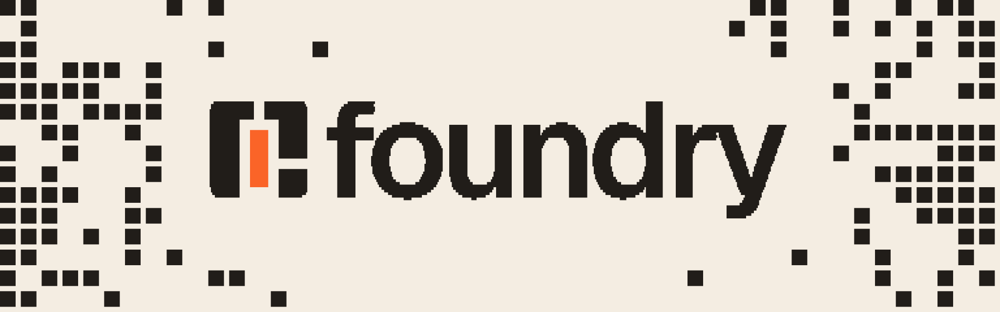

<p align="center">
  <picture>
    <source media="(prefers-color-scheme: dark)" srcset=".github/assets/banner-dark.svg">
    
  </picture>
</p>

<p align="center"><b>The app you never open. Opens everything.</b><br>A native macOS launcher in Swift: apps, files, clipboard, snippets, windows, conversions and AI in one bar.</p>

<p align="center">
  <a href="https://github.com/hridaya423/foundry/releases/latest"></a>
  
  <a href="LICENSE"></a>
</p>

<p align="center">
  <a href="https://github.com/hridaya423/foundry/releases/latest/download/Foundry.dmg"><b>Download Foundry.dmg</b></a> · <a href="https://foundry.hridya.tech">Website</a> · <a href="https://foundry.hridya.tech/methodology">Methodology</a> · <a href="https://foundry.hridya.tech/privacy">Privacy</a> · <a href="https://foundry.hridya.tech/changelog">Changelog</a>
</p>

Press ⌘ Space and type. Foundry finds the app, the file or the thing you copied an hour ago. It also does the job in the same bar: it converts a HEIC to PNG, tiles a window, expands a snippet or answers a question. The app is 9.4 MB, has no third-party Swift packages and is free under the MIT license.

## Numbers

| | Foundry | For comparison |
| --- | --- | --- |
| App size on disk | **9.4 MB** (1.3.0) | Raycast 2.5.3: 224 MB. Tinycast 0.11.3: 13.6 MB. |
| Memory after launch | **81% less than Raycast 2.5.3** (115 MB against 620 MB, Foundry 1.1.0) | Tinycast is lighter: 40 MB against Foundry's 60 to 120 MB. |
| Keystroke to results | **16.8 ms** p50, 35.6 ms p95 (1.2.0) | Engine time in a test, over 132 samples. Drawing time is not included. |
| Third-party Swift packages | **0** | `Package.swift` declares none. |

The memory figures are the worse of two order-swapped runs on an Apple M4 Pro. The app size comes from the 1.3.0 release zip. [`latest.json`](docs/benchmarks/latest.json) gives the version, the date, the machine and the raw record for each figure. In the same runs, Raycast opened its panel faster than the 1.1.0 release build. The [methodology page](https://foundry.hridya.tech/methodology) explains each test.

## Install

1. Download [Foundry.dmg](https://github.com/hridaya423/foundry/releases/latest/download/Foundry.dmg). It is signed with a Developer ID and notarized by Apple.
2. Open the DMG and drag Foundry to Applications.
3. Open Foundry and follow the four setup steps.

Setup asks before it takes ⌘ Space. If you choose "Take ⌘ Space", Foundry moves Spotlight off the shortcut, and moves Raycast or Alfred to ⌥ Space if one of them holds it. The other choice is ⌥ Space. Setup also imports your snippets from Alfred or from a Raycast export.

## What to type

| Type | You get |
| --- | --- |
| `saf` | Safari, or any app, setting or command. ⌘1 to ⌘8 open your favorites. |
| `f invoice kind:pdf` | File search, with Quick Look on Space and Finder actions on ⌘K. |
| `clipboard` | Clipboard history for text, files, links and images, stored on your Mac. |
| `5 km to miles` | The calculator. It also does dates, currencies and time zones, such as `now in sf`. |
| `left half` | One of 34 window layouts. Each one can have its own shortcut. |
| `emoji` | The emoji and symbol picker. |
| `ai draft a polite no` | An answer from Apple Intelligence on the device, or from a provider you add. |

⌘K opens every action for the selected result. Esc clears the query first and closes the panel second.

## Features

- **Launcher.** Apps, System Settings panes, Apple Shortcuts, quicklinks with arguments, and Script Commands in the Raycast format.
- **Files.** Spotlight file search, a File Shelf for files in transit, and conversion between image, audio, video, PDF and document formats. Foundry uses ImageIO, AVFoundation and PDFKit first. It installs ffmpeg, ImageMagick, pandoc or LibreOffice with Homebrew only after you approve a setup sheet.
- **Text.** Clipboard history, snippets that expand as you type, text capture from the screen (OCR), QR codes, a colour picker and developer tools for JSON, base64, UUIDs and timestamps.
- **AI.** Apple Intelligence by default. You can add OpenAI, Anthropic, Gemini and other providers, or a local server such as Ollama, LM Studio or llama.cpp. Foundry stores API keys in the Keychain.
- **Home.** Widgets for the date, CPU and memory, storage and battery, plus the shelf for your coding agents' sessions.

The [privacy page](https://foundry.hridya.tech/privacy) lists every request Foundry sends off the Mac and the line of code that sends it.

## Development

Foundry is a Swift package. It builds with Swift 6.1 (Xcode 16.3) or Swift 6.2. Liquid Glass surfaces need Swift 6.2 and fall back to the standard material on 6.1.

```sh
swift build --build-tests
swift test
./scripts/build-app.sh
```

`build-app.sh` writes `build/Foundry.app` and does not install it. Set `INSTALL_APP=1` to install it, and add `LAUNCH_APP=1` to launch it. `./scripts/check.sh` runs the lints, the test build and the website checks. [`AGENTS.md`](AGENTS.md) describes each script.

The website is a Next.js app in [`anvil/`](anvil/). Release notes are in [`docs/release-notes/`](docs/release-notes/).

## License

MIT. See [LICENSE](LICENSE) and [THIRD-PARTY-NOTICES.md](THIRD-PARTY-NOTICES.md).
